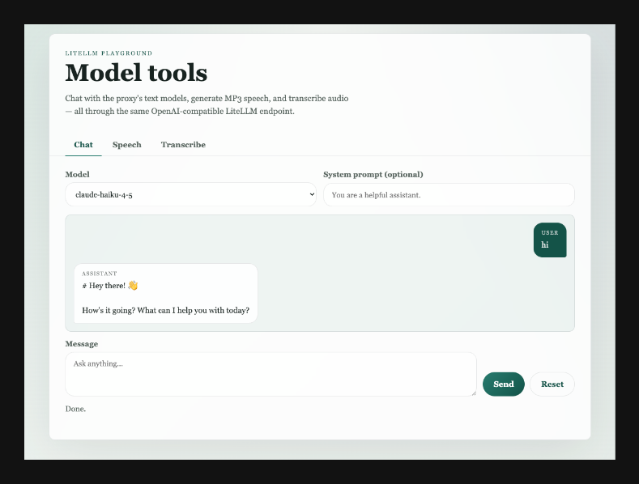
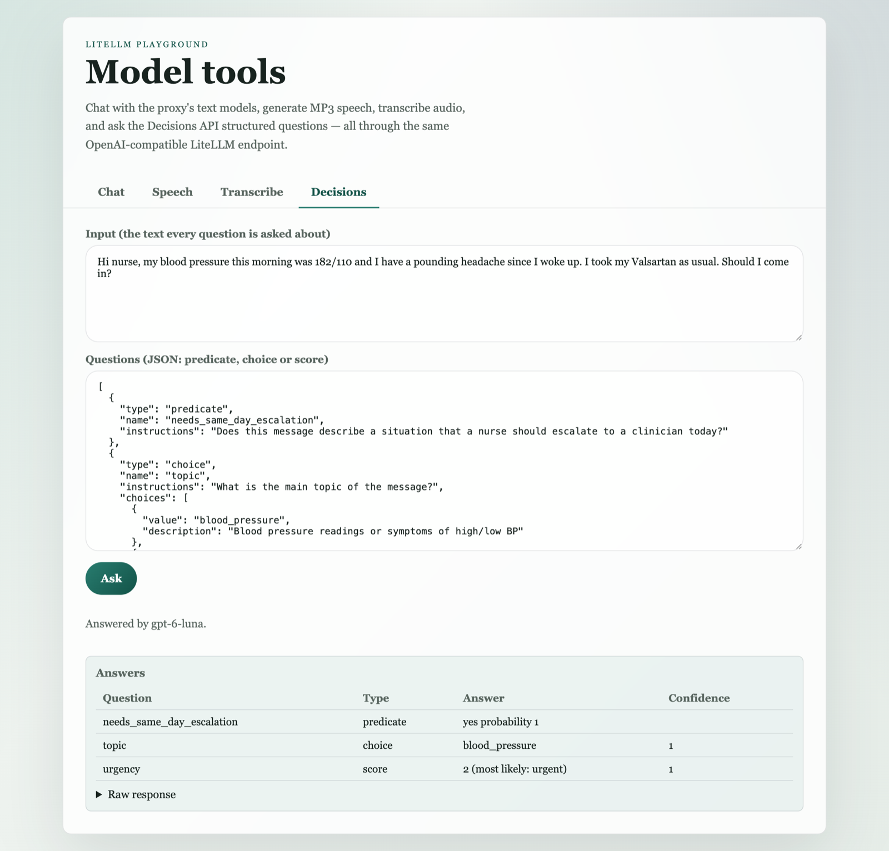

# LiteLLM Playground

Sample code for calling models through our LiteLLM proxy with the OpenAI Python SDK, plus a small FastAPI web app that
tries each one in the browser: chat (streaming), text-to-speech, audio transcription, and the Decisions API.



**Contents**

- Python samples: [Chat completion](#chat-completion) · [Streaming chat completion](#streaming-chat-completion) ·
  [List models](#list-models) · [Text-to-speech](#text-to-speech) · [Transcription](#transcription) ·
  [Decisions API](#decisions-api)
- [Run the playground app](#run-the-playground-app) · [App endpoints](#app-endpoints) · [Why this shape](#why-this-shape)

## Python samples

Every sample is self-contained. Install the SDK and point it at LiteLLM with two environment variables:

```bash
pip install "openai>=3.31.0"
export OPENAI_API_KEY=your-real-key                  # your LiteLLM key
export OPENAI_BASE_URL=https://your-litellm-host
```

### Chat completion

```python
import os
import openai

client = openai.OpenAI(
    api_key=os.environ["OPENAI_API_KEY"],
    base_url=os.environ["OPENAI_BASE_URL"],
)

response = client.chat.completions.create(
    model="claude-haiku-4-5",
    messages=[
        {"role": "system", "content": "You are a terse assistant."},
        {"role": "user", "content": "Name a primary color."},
    ],
)

print(response.choices[0].message.content)
```

### Streaming chat completion

```python
import os
import openai

client = openai.OpenAI(
    api_key=os.environ["OPENAI_API_KEY"],
    base_url=os.environ["OPENAI_BASE_URL"],
)

stream = client.chat.completions.create(
    model="gpt-5.5",
    messages=[{"role": "user", "content": "Write a 3-line haiku about streaming."}],
    stream=True,
)

for chunk in stream:
    delta = chunk.choices[0].delta.content if chunk.choices else None
    if delta:
        print(delta, end="", flush=True)
print()
```

### List models

```python
import os
import openai

client = openai.OpenAI(
    api_key=os.environ["OPENAI_API_KEY"],
    base_url=os.environ["OPENAI_BASE_URL"],
)

for model in client.models.list().data:
    print(model.id)
```

### Text-to-speech

```python
import os
import openai

client = openai.OpenAI(
    api_key=os.environ["OPENAI_API_KEY"],
    base_url=os.environ["OPENAI_BASE_URL"],
)

response = client.audio.speech.create(
    model="gpt-4o-mini-tts",
    input="Your text to convert to speech here",
    voice="alloy",
)

response.stream_to_file("output_speech.mp3")
```

OpenAI's text-to-speech docs show `gpt-4o-mini-tts` on the speech endpoint and list `alloy` among the supported voices.

### Transcription

```python
import os
import openai

client = openai.OpenAI(
    api_key=os.environ["OPENAI_API_KEY"],
    base_url=os.environ["OPENAI_BASE_URL"],
)

audio_file = open("path/to/your/audio/file.mp3", "rb")

response = client.audio.transcriptions.create(
    model="gpt-4o-transcribe",
    file=audio_file,
)

print(response.text)
```

### Decisions API

Ask a model structured questions about a piece of text and get typed answers back instead of free text.



Requirements:

- the OpenAI Python SDK v3 (`openai>=3.31.0`; `client.decisions` does not exist in 2.x);
- LiteLLM v1.104.2 or later;
- a LiteLLM model whose provider supports Decisions, such as `gpt-6-luna-openai` (`openai/gpt-6-luna`). An Azure OpenAI
  deployment returns `Unknown Decisions provider 'azure'`.

Question types:

| `type` | You give | You get back |
| --- | --- | --- |
| `predicate` | `instructions` (a yes/no question) | `probability` that the answer is yes |
| `choice` | `instructions` + 2–255 `choices` (`value`, optional `description`) | `choice`, `probabilities`, `confidence` |
| `score` | `instructions` + 2–10 `levels` (`label`, optional `description`), lowest first | `score` (the expected level, 0 = lowest), `probabilities`, `confidence` |

```python
import os
import openai

client = openai.OpenAI(
    api_key=os.environ["OPENAI_API_KEY"],
    base_url=os.environ["OPENAI_BASE_URL"],
)

response = client.decisions.create(
    model="gpt-6-luna-openai",
    input="Hi nurse, my blood pressure this morning was 182/110 and I have a pounding headache. Should I come in?",
    questions=[
        {
            "type": "predicate",
            "name": "needs_same_day_escalation",
            "instructions": "Does this message describe a situation that a nurse should escalate to a clinician today?",
        },
        {
            "type": "choice",
            "name": "topic",
            "instructions": "What is the main topic of the message?",
            "choices": [
                {"value": "blood_pressure"},
                {"value": "blood_glucose"},
                {"value": "medication_refill"},
                {"value": "other"},
            ],
        },
        {
            "type": "score",
            "name": "urgency",
            "instructions": "How urgent is this message for the care team?",
            "levels": [{"label": "routine"}, {"label": "soon"}, {"label": "urgent"}],
        },
    ],
)

for answer in response.answers:
    print(answer.name, answer.type, answer.model_dump(exclude_none=True))
```

#### With curl

```bash
curl -s "$OPENAI_BASE_URL/v1/decisions" \
  -H "Authorization: Bearer $OPENAI_API_KEY" -H "Content-Type: application/json" \
  -d '{"model": "gpt-6-luna-openai",
       "input": "Can I move my Thursday check-in call to Friday afternoon?",
       "questions": [{"type": "predicate", "name": "is_reschedule", "instructions": "Is the patient asking to move an appointment?"}]}'
```

#### System One format

LiteLLM also serves the same models in the System One format at `/v1/systemone`: `state` instead of `input`, questions
as a named map, `noul` instead of `predicate`, and `criteria` for choices and levels.

```bash
curl -s "$OPENAI_BASE_URL/v1/systemone" \
  -H "Authorization: Bearer $OPENAI_API_KEY" -H "Content-Type: application/json" \
  -d '{"model": "gpt-6-luna-openai",
       "state": "Can I move my Thursday check-in call to Friday afternoon?",
       "questions": {"is_reschedule": {"type": "noul", "instructions": "Is the patient asking to move an appointment?"},
                     "urgency": {"type": "score", "criteria": ["Routine", "Soon", "Urgent"]}}}'
```

## Run the playground app

The app serves a tabbed page (Chat / Speech / Transcribe / Decisions) and a small JSON API from one container on port
8000.

### Prerequisites

- `uv`
- Docker + Docker Compose (optional)
- A valid LiteLLM/OpenAI-compatible API key and endpoint

### Configure

```bash
cp .env.example .env
```

Then edit `.env` and set:

```env
OPENAI_API_KEY=your-real-key
OPENAI_BASE_URL=https://your-litellm-host
OPENAI_TTS_MODEL=gpt-4o-mini-tts
OPENAI_TRANSCRIBE_MODEL=gpt-4o-transcribe
OPENAI_DECISIONS_MODEL=gpt-6-luna-openai
```

### Run locally with uv

```bash
uv sync --dev
uv run uvicorn app.main:app --reload --host 0.0.0.0 --port 8000
```

Open `http://localhost:8000`.

### Run with Docker Compose

```bash
docker compose up --build
```

Open `http://localhost:8000`.

### Test

```bash
uv run pytest -q
```

### Health check

```bash
curl http://localhost:8000/health
```

Expected response:

```json
{"status":"ok"}
```

### App endpoints

| Method | Path | Returns |
| --- | --- | --- |
| GET  | `/health` | `{"status":"ok"}` |
| GET  | `/api/models` | `{"models": [...]}` — chat-capable models from the proxy |
| POST | `/api/chat` | streaming `text/plain` deltas; body `{"model","messages":[{"role","content"}]}` |
| POST | `/api/tts` | MP3 bytes; body `{"text","voice"}` |
| POST | `/api/transcribe` | `{"text": ...}`; multipart `file` upload |
| POST | `/api/decisions` | `{"model", "answers": [...]}`; body `{"input", "questions": [...]}` (1–128 questions) |

### How the page works

- The frontend is a single static page with four tabs: Chat, Speech, Transcribe and Decisions.
- Chat streams via `response.body.getReader()` against `/api/chat`. Conversation history is kept client-side.
- The Decisions tab is prefilled with a sample patient message and three questions; edit the JSON to try your own.

## Why this shape

- `uv` manages the Python environment locally.
- FastAPI exposes a small JSON API and serves the frontend from the same container.
- Docker Compose gives you a clean, repeatable runtime with the same dependency set as local dev.
